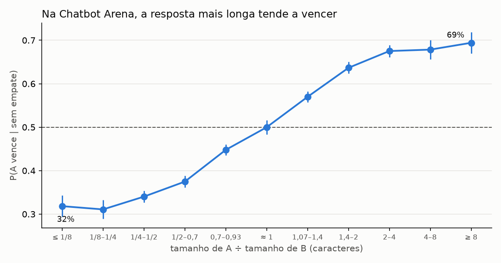
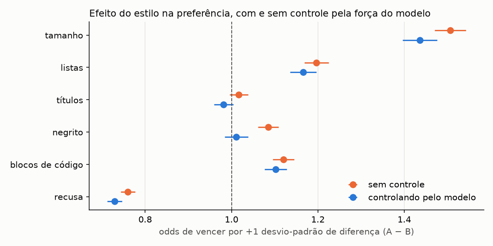

# kaggle-llm-preference

Prever qual de duas respostas de chatbot um humano prefere, com dados da Chatbot Arena: competição [LLM Classification Finetuning](https://www.kaggle.com/competitions/llm-classification-finetuning) do Kaggle (57.477 batalhas entre 64 LLMs; classes: A vence, B vence, empate; métrica: log loss). É o problema dos **reward models** do RLHF e dos **LLM-as-a-judge**.

O projeto tem três partes:

1. **Que vieses os humanos têm ao escolher?** (feito, abaixo)
2. **Reward model próprio:** LLM pequeno ajustado com LoRA, comparado ao baseline (em andamento)
3. **Que vieses o reward model herda?** Testes controlados: mesma resposta encurtada, A↔B trocados

## 1. Vieses humanos na Chatbot Arena

`scripts/analyze_bias.py`, sobre as 39.716 batalhas sem empate.



**Verbosidade é o viés dominante.** Quando A é de 2 a 4 vezes mais longa que B, A vence 68% das batalhas decisivas; quando é de 2 a 4 vezes mais curta, vence 34%.

Mas modelos melhores também escrevem mais. Para separar estilo de qualidade, ajustei um modelo de Bradley-Terry com a força de cada um dos 64 modelos e as diferenças de estilo (A − B) como covariáveis, a ideia do *style control* da LMSYS, implementada do zero em `src/lp/bias.py` e validada em dados sintéticos com confundidor conhecido (`tests/test_bias.py`):



| Estilo (A − B, +1 desvio-padrão) | Odds de vencer, sem controle | Controlando pelo modelo |
|---|---|---|
| tamanho | 1,51 | **1,44** |
| listas | 1,20 | 1,17 |
| blocos de código | 1,12 | 1,10 |
| negrito | 1,09 | 1,01 (some) |
| títulos | 1,02 | 0,98 (some) |
| recusa ("I'm sorry", "As an AI"…) | 0,76 | **0,73** |
| posição (ser a resposta A) | 1,03 | 1,03 |

- **O viés de tamanho quase não é explicado pela qualidade do modelo:** com o mesmo par de modelos, a resposta mais longa ainda tem 44% mais chance de vencer por desvio-padrão.
- **Recusar custa caro:** recusar quando o outro não recusa reduz as odds em ~27%.
- **Negrito e títulos não importam por si:** o efeito bruto vinha dos modelos que os usam.
- **Posição:** A vence 50,5% ± 0,25% das batalhas decisivas, um viés pequeno mas detectável. 31% das batalhas são empate.

Ressalva: dados observacionais. O controle pelo modelo não remove confundidores dentro do mesmo modelo (perguntas difíceis pedem respostas mais longas e melhores); a parte 3 testa o efeito do tamanho com intervenção.

## 2. Modelos

Validação: GroupKFold por prompt (o mesmo prompt aparece em várias batalhas).

| Modelo | Log loss (CV) | LB público |
|---|---|---|
| prior constante | 1,097 | — |
| features de forma + LightGBM, com aumento A↔B | 1,029 | pendente |
| reward model com LoRA | — | — |

O aumento A↔B treina com a cópia trocada e, na previsão, faz a média com a previsão trocada de volta, o que força P(A vence | A, B) = P(B vence | B, A).

Referência: os notebooks públicos perto de 0,83 fazem inferência com Gemma-2 9B e Llama-3 8B ajustados por terceiros na competição LMSYS original. Esta é uma competição *Getting Started*, sem medalhas; o objetivo aqui é o entendimento, não o ranking.

## Como rodar

```bash
uv sync
uv run pytest
uv run python scripts/analyze_bias.py        # parte 1 (~1 min): results/bias.json e figuras
uv run python scripts/run_cv.py              # baseline (~4 min)
uv run python scripts/build_kaggle_notebook.py
```

Os dados ficam fora do git (`LP_DATA` ou a pasta baixada do Kaggle ao lado do projeto); as regras do Kaggle não permitem redistribuí-los.

## Licença

MIT.
